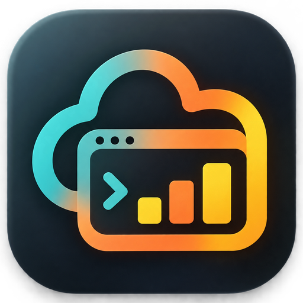
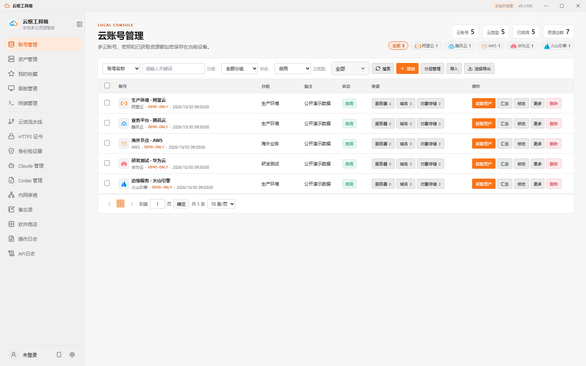
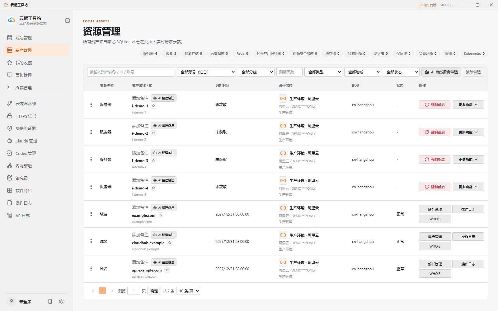
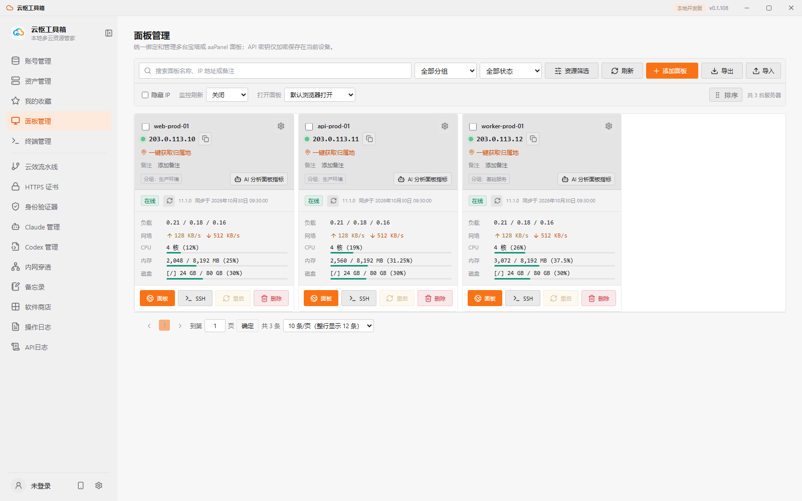
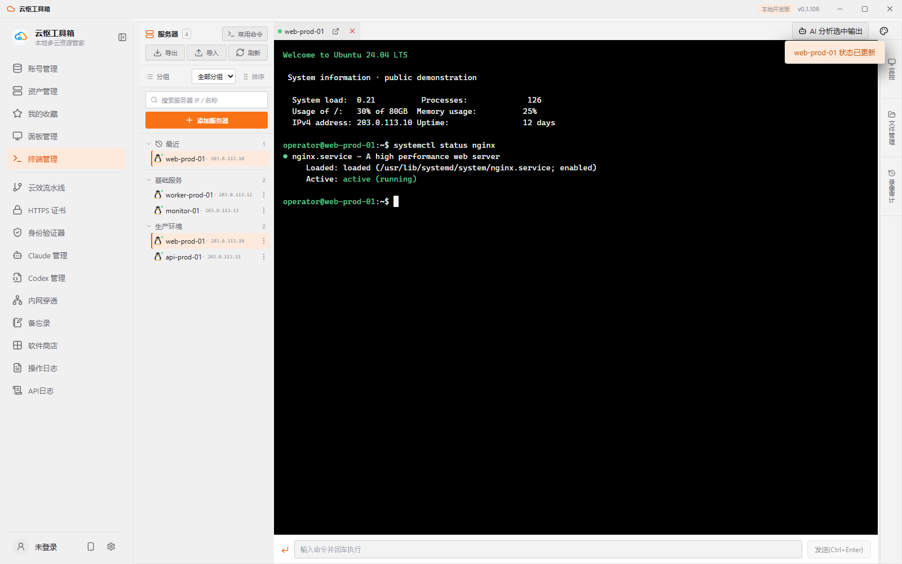
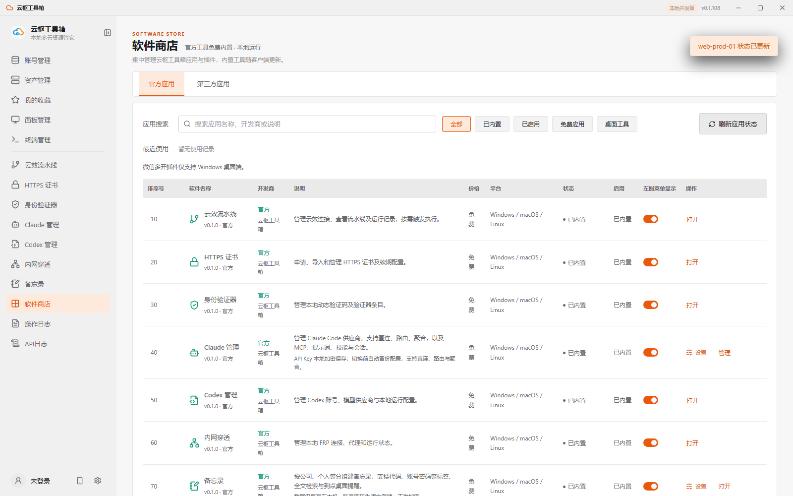
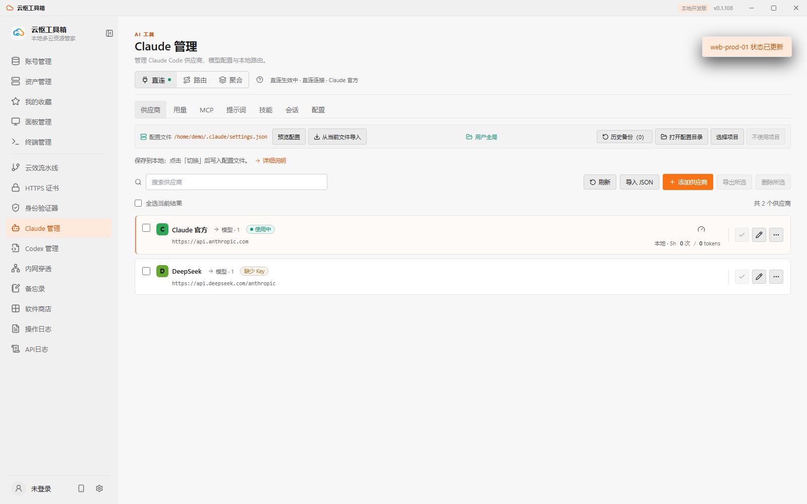
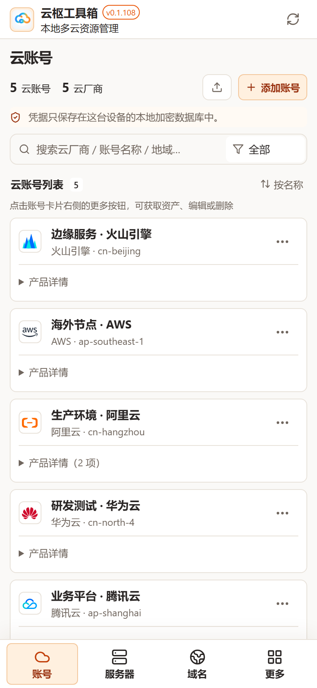
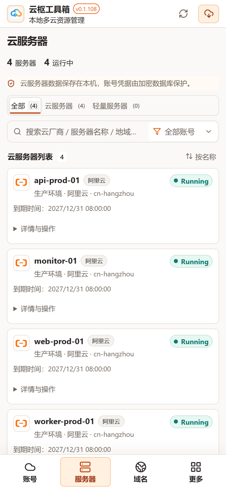
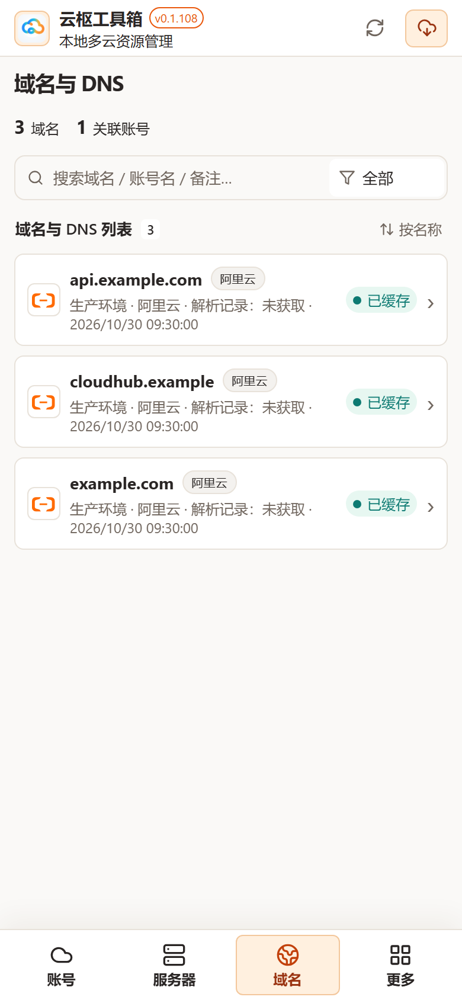

<p align="center">
  
</p>

<h1 align="center">云枢工具箱 · CloudHub Tools</h1>

<p align="center">
  本地优先的多云资源管理工具箱
</p>

<p align="center">
  <a href="https://github.com/wlphp/cloudhub-tools/releases"></a>
  
  
  
  
</p>

云枢工具箱把分散在不同云厂商的账号、服务器、域名、数据库和存储资源集中到一个本机客户端中管理，并提供域名解析、对象存储浏览、终端连接、面板监控、HTTPS 证书、内网穿透和操作审计等能力；同时内置软件商店、AI 辅助与桌面宠物。

基于 Tauri 2 + React 19 构建，桌面端与手机端同版本发布：

- **桌面端**：Windows x64、macOS（Apple Silicon / Intel）
- **手机端**：Android ARM64（APK）、iOS（未签名 Xcode 归档，需自行签名侧载）

账号凭证、同步资产和操作记录默认保存在当前设备。当前发布渠道暂不提供 Linux 安装包。

## 界面预览

桌面端 v0.1.108 亮色主题，以下截图使用公开演示数据，不包含真实账号或凭据。

| 账号管理 | 资产管理 |
| --- | --- |
|  |  |
| **面板管理** | **终端管理** |
|  |  |
| **软件商店** | **Claude 管理** |
|  |  |

### 手机端预览

以下为手机端 v0.1.108 亮色主题截图，演示数据仅用于展示，不包含真实账号或凭据。

<table>
  <tr>
    <th>云账号</th>
    <th>云服务器</th>
    <th>域名与 DNS</th>
  </tr>
  <tr>
    <td></td>
    <td></td>
    <td></td>
  </tr>
</table>

## 核心功能

- **多云账号管理**：维护账号、分组、默认地域和启用状态，支持凭证加密保存与部分云账号连通性验证；账号列表按厂商展示品牌图标，并支持多选筛选。
- **资源同步与汇总**：按账号选择资源类型同步到本地 SQLite；可按云厂商、地域、资源类型、状态和关键字筛选，并收藏常用资源。
- **云资源管理**：覆盖服务器、域名、对象存储、云数据库、Redis、轻量应用服务器及边缘安全加速等常用资产；部分资源支持改名、启动、停止、重启或强制重启。
- **域名与 DNS**：查看域名解析记录、操作日志和 WHOIS；在已支持写入的云厂商中可添加、编辑、启停和删除解析记录。
- **对象存储**：查看存储桶和部分桶的详情、文件列表、容量统计、CNAME 与 CORS 配置；支持的服务商可绑定或移除自定义域名。
- **终端管理**：从云资源直接打开 SSH 或 Windows RDP；SSH 支持密码、私钥和私钥口令，提供远程目录浏览、文件上传下载、编辑和删除，以及快捷命令、终端审计等运维辅助。
- **面板管理**：统一接入宝塔面板和 aaPanel，查看面板在线状态、版本、CPU、内存、磁盘与网络信息，并可快速打开面板或关联服务器的 SSH。
- **本地审计**：保留本机操作日志和云 API 请求日志，便于回溯账号与资源操作。

## 软件商店与内置应用

第一批官方应用随应用编译发布，在「软件商店」中按需启用，可配置是否显示在侧边栏；应用不加载第三方插件代码。

| 应用 | 分类 | 说明 | 平台 |
| --- | --- | --- | --- |
| 云效流水线 | 开发工具 | 管理云效连接、查看流水线及运行记录，按需触发执行 | 桌面 |
| HTTPS 证书 | 运维工具 | 申请、导入和管理 HTTPS 证书及续期配置 | 桌面 |
| 身份验证器 | 安全工具 | 管理本地动态验证码及验证器条目 | 桌面 |
| Claude 管理 | 开发工具 | 管理 Claude Code 供应商（直连、路由、聚合），以及 MCP、提示词、技能与会话 | 桌面 |
| Codex 管理 | 开发工具 | 管理 Codex 账号、模型供应商与本地运行配置 | 桌面 |
| 内网穿透 | 运维工具 | 管理本地 FRP 连接、代理和运行状态 | 桌面 |
| 备忘录 | 桌面工具 | 按公司、个人等分组建备忘录，支持代码、账号密码等标签、全文检索与到点桌面提醒 | 桌面 |
| 微信多开 | 桌面工具 | 启动本机微信，按账号保存并恢复登录配置 | Windows |
| 电脑信息 | 桌面工具 | 查看本机硬件、网络、代理与电源信息，检测摄像头并按需显示当前 Wi-Fi 密码 | 桌面 |
| WSL 管理 | 桌面工具 | 查看并管理本机 WSL 发行版，支持启动、停止、备份、设为默认及删除 | Windows |
| 指纹浏览器 | 桌面工具 | 管理独立浏览器环境、代理和登录资料，浏览器内核首次使用时下载 | Windows |

## AI 辅助与桌面宠物

- **AI 服务**：接入 OpenAI（Chat Completions / Responses）、Claude Messages、Gemini 等兼容接口，用于表单识别填写、SSH 命令草稿、错误与日志分析、DNS 解析建议、资源摘要与资产搜索；识别截图可先涂黑敏感区域再提交。
- **桌面宠物**：常驻桌面的宠物窗口，承接备忘录到点提醒、AI 聊天与生活状态气泡，并可确认执行关机、重启等本机操作。

## 手机端

手机 App 与桌面端同版本发布，覆盖账号管理、云服务器、域名解析、对象存储、云数据库、Redis、证书、SSH、面板与日志查询。桌面端可通过侧边栏「手机端下载」扫码或跳转 Releases 获取安装包。

## 已接入云服务商

阿里云、腾讯云、火山引擎、天翼云、Oracle Cloud、华为云、百度智能云、京东云、UCloud、青云 QingCloud、金山云、七牛云、AWS、Microsoft Azure、Google Cloud 和 Vultr。

各云厂商的 API 能力和授权模型不同，因此同步资源类型、资源详情和可写操作并不完全一致。应用会在界面中标注仅支持读取的能力；例如部分云厂商当前仅支持资产或存储桶清单同步。

## 支持的资源类型

- 服务器与轻量应用服务器
- 域名与 DNS 解析
- 对象存储桶
- 云数据库与 Redis
- 边缘安全加速
- Vultr 的块存储、私有网络、防火墙、保留 IP、负载均衡、快照和 Kubernetes 等资源

## 本地数据与安全

- 账号密钥、面板 API Key 和已保存的 SSH 密码均使用本机生成的密钥加密后保存。
- AccessKey Secret 不会在账号列表中明文显示。
- Windows 数据库默认位于 `%LOCALAPPDATA%\CloudHubTools\cloudhub_tools.sqlite3`。
- macOS 数据库默认位于 `~/Library/Application Support/CloudHubTools/cloudhub_tools.sqlite3`。
- 操作日志和 API 日志仅保存在当前设备。
- 界面语言当前为简体中文，英文界面翻译开发中。

## 本地运行

### 环境要求

- Node.js
- Rust 工具链
- Windows：Visual Studio C++ Build Tools
- macOS：Xcode Command Line Tools
- 手机端：Android SDK / NDK（Android），Xcode（iOS，仅 macOS 构建）

### Windows

双击 `run-desktop-dev.bat`，或在 PowerShell 中运行：

```powershell
./run-desktop-dev.bat
```

首次启动需要编译 Rust 依赖。前端开发服务默认运行在 `http://127.0.0.1:1420`；账号加密存储、SSH 和本机数据库等功能需要通过 Tauri 桌面客户端使用。

桌面调试构建使用独立的 `CloudHubTools-Dev` 数据目录（不读取正式版数据），开发版窗口显示“开发版”并禁用正式版更新与网关自动启动；需要测试数据时可通过导出/导入功能显式迁移。

桌面端升级数据库 schema 前，会自动在数据目录的 `schema-backups/` 下保存数据库快照与配套密钥；遇到高于当前客户端支持的 schema 版本时会拒绝打开，请使用兼容的新客户端，不要手动修改 `user_version`。

### 前端开发预览

```powershell
npm install
npm run web:api   # 一个终端启动本地 API，默认端口 1430
npm run dev       # 另一个终端启动前端
```

修改端口时，API 进程使用 `CLOUDHUB_TOOLS_WEB_API_PORT`，前端进程使用 `VITE_CLOUDHUB_TOOLS_WEB_API_PORT`，两者必须设为相同值。

本地 API 默认只允许来自 `http://127.0.0.1:1420` 与 `http://localhost:1420` 的浏览器请求；其他本机地址可通过逗号分隔的 `CLOUDHUB_TOOLS_WEB_ALLOWED_ORIGINS` 配置。浏览器预览不提供账号 Secret 明文读取或密钥导出，这些敏感操作仅能在 Tauri 桌面端执行。

### 手机端开发

```powershell
npm run dev:mobile    # 以手机端目标启动前端
npm run tauri android # Android 开发与构建
npm run tauri ios     # iOS 开发与构建（仅 macOS）
```

Windows 用户也可以双击 `run-mobile-web.bat` 启动手机端 Web 调试。它使用 `http://127.0.0.1:1421`，避开桌面端默认使用的 1420 端口，并在服务就绪后自动打开浏览器；本地 Web API 使用 1430 端口。

## 构建与发布

### 构建桌面安装包

```powershell
npm install
npm run tauri build
```

安装包将生成到 `src-tauri\target\release\bundle\`。Windows 默认生成 NSIS 安装器和 MSI（MSI 同时生成英文和简体中文版本）。

### 构建 macOS 安装包

必须在 macOS 系统中执行：

```bash
npm install

# 通用包，同时支持 Apple Silicon 和 Intel Mac
npm run bundle:mac

# 仅 Apple Silicon
npm run bundle:mac:arm64

# 仅 Intel Mac
npm run bundle:mac:x64
```

生成的 `.app` 和 `.dmg` 位于 `src-tauri/target/<target>/release/bundle/`。未使用 Apple Developer 证书签名的包仅适合内部测试；对外发布前请完成签名和公证。

### GitHub Release

推送形如 `v0.1.84` 的版本标签会自动创建 GitHub Release，并上传以下安装包：

- Windows x64（NSIS 与 MSI）
- macOS Apple Silicon（M 系列芯片）和 macOS Intel
- Android ARM64 APK（使用已有签名证书签名后上传）
- iOS 未签名 Xcode 归档（不能直接作为 IPA 安装，需自行签名侧载）

已安装的桌面客户端会在启动时检查新版本，也可以在“系统设置”中手动检查、下载并安装更新。维护发布流程需要在 GitHub Actions Secrets 中配置 `TAURI_SIGNING_PRIVATE_KEY` 签名更新包，私钥不能提交到仓库。

## 技术栈

- 前端：React 19、TypeScript、Vite
- 桌面端与手机端：Tauri 2、Rust
- 终端：xterm.js
- 本地存储：SQLite
- 端到端测试：Playwright

## 许可证

本项目采用 [PolyForm Noncommercial License 1.0.0](LICENSE) 授权，源码公开但禁止商业用途。
该许可证允许个人、研究、教育、公益和政府机构等非商业使用；商业使用需获得版权所有者的单独授权。
由于包含非商业限制，本项目不属于 OSI 严格定义的“开源软件”。

## ❤️ 赞助商

> [想出现在这里？](https://github.com/wlphp/cloudhub-tools/issues/new?title=%E8%B5%9E%E5%8A%A9%E5%90%88%E4%BD%9C)

<table>
  <tr>
    <td align="center" width="240">
      <a href="https://linux.do"><strong>LINUX DO</strong><br><sub>新的理想型社区</sub></a>
    </td>
    <td>
      感谢 <a href="https://linux.do">Linux.do</a> 社区对本项目的支持！欢迎前往 Linux.do，与社区开发者交流并分享技术经验。
    </td>
  </tr>
</table>
